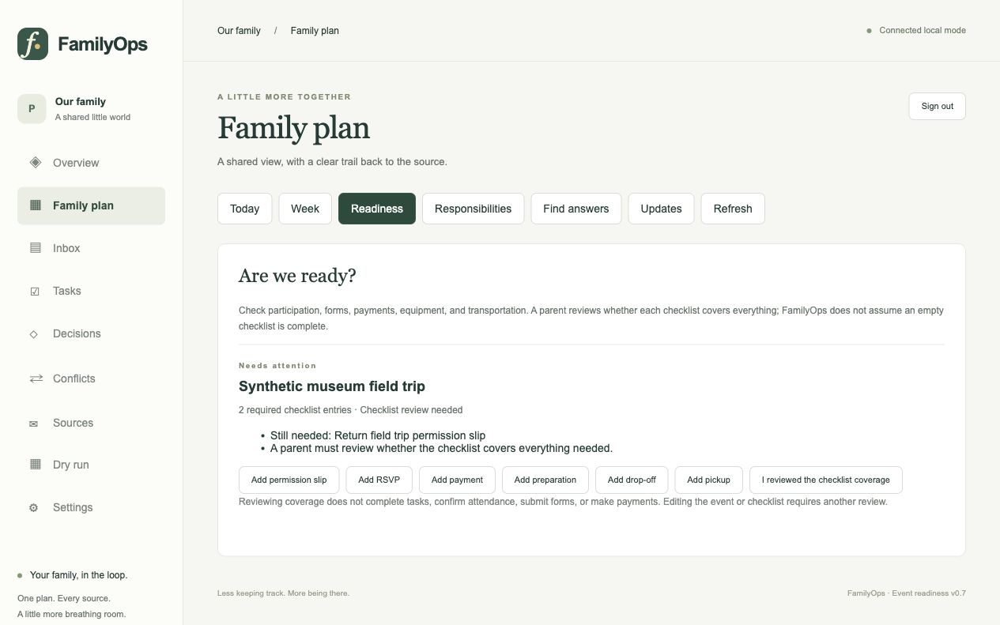

# dacodac.

**Family life, sorted.**  
*One family. A million moving parts. All handled.*

An AI-powered family operations platform exploring intelligent coordination, human-centered automation, and privacy-first product design.

> dacodac is an engineering project, not a publicly launched or production-ready service. The current showcase is documentation-first. Real-family enrollment, production AI, external integrations, child access, calendar writes, and autonomous actions are not enabled.

## The problem

Family logistics arrive through many separate channels: school notices, activity schedules, forms, messages, and calendars. Parents and guardians must work out what changed, who needs to act, and whether two sources describe the same event. Important details can be missed or duplicated while the family tries to keep everyone coordinated.

dacodac is designed to turn authorized family information into a shared, reviewable plan while preserving the evidence and source behind each proposed item.

## Product vision

The intended users are parents and guardians coordinating school, activities, appointments, household responsibilities, and shared calendars. A family should be able to keep its existing accounts, devices, and calendar while reviewing relevant information together.

The product is built around a simple rule: software can organize, compare, and propose; people retain control over ambiguous or consequential decisions. Conflicts and uncertain details go to review. A calendar change requires a separate approval path.

## What works today

The local application and its automated tests cover a meaningful set of family-planning workflows. The current evidence supports these statements:

- A FastAPI backend and a Next.js/TypeScript interface support a synthetic local demo.
- The normalized domain separates source records, family items, evidence, review decisions, tasks, and audit history.
- Review, task ownership, preparation checklists, event readiness, conflict display, and source attribution are represented in working application flows.
- PostgreSQL migrations, tenant boundaries, runtime-role checks, and row-level-security behavior have been exercised against a disposable local PostgreSQL instance.
- The latest recorded backend run, dated November 12, 2026, passed 1,069 tests with no failures or skips; frontend type and production-build checks passed. The earlier run had 1,054 passes and 15 PostgreSQL-dependent skips. The later run used a disposable local PostgreSQL 16.15 instance with TLS; neither result is hosted or production acceptance. See [the sanitized test evidence summary](docs/test-evidence-summary.md).

These are local engineering results. They do not establish live provider acceptance, hosted staging acceptance, production reliability, or user adoption.

### Current status at a glance

| Area | Status |
|---|---|
| Local product workflows | Implemented and covered by automated tests using synthetic data |
| Database tenant isolation | Tested locally with PostgreSQL; hosted acceptance remains pending |
| Source adapters | Partial; provider access varies and real family accounts have not been validated |
| AI prioritization and disruption mitigation | Research/prototype work only; production AI is disabled |
| AWS application staging | <!-- DACODAC_AUTO_README_BEGIN --> Not deployed; limited risk exception accepted for fictional staging; initial-write authorization pending. <!-- DACODAC_AUTO_README_END --> |
| Real-family enrollment | Closed |
| Public production release | Not authorized |

## How the system is organized

The web application provides the family-facing review and planning experience. A Python API applies workspace membership and authorization rules, coordinates source adapters, and persists normalized items and evidence in a PostgreSQL-compatible data model. Source-specific adapters are kept separate so that access, permissions, and coverage can be verified independently.

The system is designed to preserve where information came from, reconcile duplicates without silently merging conflicting facts, and keep consequential changes behind human review. The architecture diagram distinguishes the synthetic/local application path from external provider paths that are still unverified or planned. Email and calendar inputs are not represented as live connections.

See [Architecture](docs/architecture.md) for the detailed explanation and diagram.

## Product demonstration

This is an actual interface capture from a local synthetic-data demo. It shows an event-readiness checklist for a fictional field trip; it is not a live service or a claim that the example came from a real family.

The screenshot predates the dacodac. product branding and still displays the internal engineering name, FamilyOps. No interactive public demo is available because the hosted application has not passed its staging security gate.

## AI status

AI is part of the product direction, but not an active production capability. Local research prototypes explore extraction and obligation coverage using synthetic inputs. The production AI quality gate has not passed; no real-family information is used for inference, and automated prioritization or disruption mitigation is not active.

## Engineering approach

- **Product and architecture direction:** Nick Perry defined the problem, product goals, boundaries, architecture choices, and acceptance requirements.
- **AI-assisted implementation:** coding agents contributed generated code, tests, and documentation under owner direction. This repository is curated documentation, not the private development source tree.
- **Verification:** behavior is described only where supported by current local test and build evidence. A successful test run is treated as engineering evidence, not as production approval.
- **Governance:** milestones distinguish implemented behavior, prototypes, planned integrations, and release authorization.

The [technical case study](docs/case-study.md) describes key decisions, trade-offs, failures, and lessons.

## Current limitations and roadmap

The next work is controlled staging readiness, live acceptance of authorized provider connections, review of the remaining base-image vulnerabilities, and operational validation such as backup/restore and alert delivery. School and activity integrations are being tracked separately; an integration on the roadmap does not mean an account is connected or that a vendor API is available.

Production AI, real-family enrollment, child accounts, trusted-adult access, autonomous actions, and public release require separate governance and acceptance decisions. See [Status and roadmap](docs/status-and-roadmap.md).

## Repository scope

This is a fresh, curated showcase with independent Git history. It intentionally contains no application source, deployment templates, infrastructure identifiers, credentials, private databases, customer information, internal evaluation corpora, or historical private repository history. No open-source license has been applied. The LinkedIn draft is in [linkedin-post.md](linkedin-post.md); do not post it until the repository is public.

## About this showcase

Product: **dacodac.**  
Engineering codename: **FamilyOps**  
Tagline: **Family life, sorted.**
