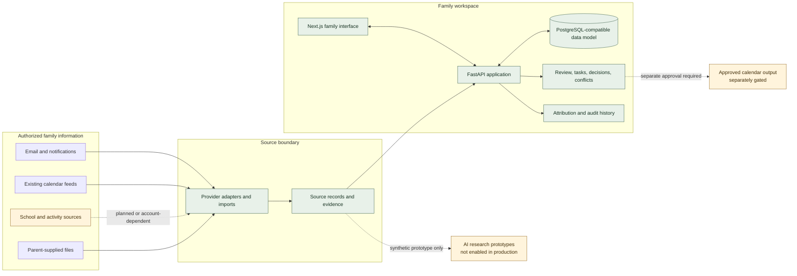

# Architecture and product boundaries

## Overview

dacodac is designed as a family workspace with a reviewable information pipeline. The current local application uses a Next.js/TypeScript web client, a Python FastAPI service, and a relational domain model that can run against PostgreSQL. Provider adapters sit at the edge of the system; normalized family records are kept distinct from the original source evidence.

The diagram uses solid lines for application paths exercised in local engineering and dashed lines for future, prototype-only, or disabled paths. It is a sanitized conceptual view; it intentionally omits infrastructure names, endpoints, credentials, and deployment policy details.

## Frontend and backend

The browser interface supports review and coordination workflows. The FastAPI service owns application rules, data validation, source processing, and persistence. The interface does not receive provider credentials or make provider decisions on its own. Local demo mode uses synthetic records; it is distinct from a hosted deployment.

## Data model and provenance

The domain separates:

- **Source records:** what an authorized provider or parent supplied, with source attribution and processing state.
- **Family items:** normalized events, obligations, reminders, or logistics proposed from one or more records.
- **Evidence:** the supporting details needed for a person to review a proposal.
- **Reviews and decisions:** human choices, including dismissing, accepting, or resolving a conflict.
- **Tasks and audit history:** assigned follow-up and a record of meaningful changes.

Deduplication can link repeated information, while conflicting dates, times, locations, or obligations remain reviewable. The product is intended to preserve the original source so a family member can understand why an item appears.

## Workspace access and family roles

The current engineering foundation includes account-to-workspace membership, authorization checks, tenant-isolation tests, and PostgreSQL row-level-security acceptance against a disposable local database. The one-workspace-per-identity limit is part of the restricted beta design.

Parent/guardian and family authority concepts are represented in the product and governance work. This does not mean every role has been verified for a live family. Child sign-in, child-specific access, and trusted-adult access are not enabled. Future delegation must be explicit, scoped, revocable, and auditable.

## AI prioritization and disruption mitigation

The long-term concept is to identify obligations, deadlines, relevant family members, changes, and schedule conflicts, then suggest a prioritized response or mitigation. Research prototypes use synthetic material only. Production inference, family-data processing, automatic decisions, and autonomous actions remain disabled. The AI production-quality gate has not passed.

## Integrations

Each integration is treated as a separate permission and coverage boundary. The product should use documented, authorized APIs, calendar feeds, or content deliberately supplied by a parent. A roadmap entry is not evidence of a working vendor connector or an authorized family account.

Some provider-specific code exists, but live access and coverage are not generally verified. Canvas is partially implemented but awaits institution registration and account-level acceptance; direct Skyward access remains planned. sportsYou is planned to begin with its documented iCal subscription. GroupMe, PlayMetrics, and other education/activity sources have distinct implementation and verification statuses. No vendor credentials or team data are included in this showcase.

## Privacy and security considerations

- Use the family's existing accounts and calendar; do not require a new family mailbox or calendar.
- Retain only authorized and relevant information, with source attribution and review context.
- Keep each workspace isolated and test that one workspace cannot access another's records.
- Keep secrets server-side and separate provider authorization from family membership.
- Require human review for ambiguity and consequential changes.
- Keep real-family enrollment, production AI, calendar sending, child access, trusted-adult access, and autonomous actions disabled until separately approved.

These are product and engineering requirements, not a claim that the service is production-certified or free of security risk. The latest local checkpoint identified unresolved container OS vulnerability findings; application staging remains blocked pending vendor remediation or an explicit owner risk decision.
